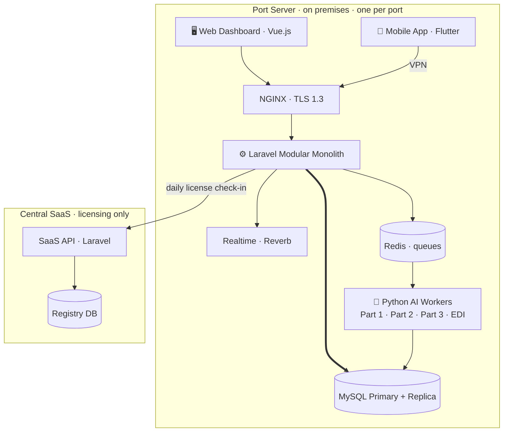

<div align="center">

# ⚓ ATLANTECH — PortHub

### Intelligent Port Operations

*An AI-Driven Predictive Decision Support System for Port-Wide Coordination of Shared Marine and Terminal Resources*


> **ATLANTECH recommends and coordinates. Existing terminal and port systems execute.**

</div>

---

## 📖 About

A port is a cluster of independent parties — port authority, pilotage, tugs, container and non-container terminals — that each plan their own resources but compete for the same finite shared ones: **berths, the navigation channel, tugs and pilots**. Each party can execute correctly while the port as a whole suffers conflicts and cascading delays.

ATLANTECH is a **port-wide advisory, recommendation and coordination layer** that sits above existing execution systems (TOS, PMIS) without replacing them. It:

- 🌊 Computes **environmentally feasible entry windows** (wind, visibility, waves, tide & surge, under-keel clearance).
- 🧠 Produces **coordinated berth, tug and pilot allocations** across terminals with a constraint solver.
- 📦 Recommends **container-yard placement** for the Container Terminal from BAPLIE (EDI) data.
- 🔁 Learns from actual outcomes through a **local, guarded feedback loop**.
- ✅ Keeps a **human approval gate** on every plan.

**PortHub** is the umbrella repository that brings every ATLANTECH component together as Git submodules.

---

## 🗂️ Repositories

| Component | Repository | Stack | Description |
|---|---|---|---|
| ⚙️ **Backend** | [`project-backend`](https://github.com/Atlantech-project/project-backend) | Laravel · PHP · MySQL · Redis · Reverb | Modular-monolith Port API, RBAC, licensing, realtime, scheduler |
| 🧠 **AI** | [`project-ai`](https://github.com/Atlantech-project/project-ai) | Python · OR-Tools · LightGBM · pyTMD | Predictive & environmental engine, allocation solver, feedback loop, EDI parser |
| 🖥️ **Frontend** | [`project-frontend`](https://github.com/Atlantech-project/project-frontend) | Vue.js · SSE | Web dashboard for port and terminal staff |
| 📱 **Mobile** | [`project-mobile`](https://github.com/Atlantech-project/project-mobile) | Flutter · WebSocket | Offline-first field app for pilots, tug masters and supervisors |

---

## 🏗️ System Architecture



- **One full installation per port**, on premises. The Central SaaS holds licensing and the port registry only — **no operational data or AI models ever leave the port**.
- Laravel talks to the Python workers asynchronously over Redis (`queue:part1`, `queue:part2`, `queue:edi`); results are written to MySQL and pushed to clients over SSE / WebSocket.

---

## 🔄 Request Lifecycle

```
SUBMITTED → PRELIMINARY_APPROVED → CUSTOMS_APPROVED
   → [AI Part 1] → ENTRY_WINDOW_CONFIRMED   (👤 human gate 1)
   → [AI Part 2] → RECOMMENDATION_GENERATED → PLAN_CONFIRMED  (👤 human gate 2)
   → COMPLETED → [AI Part 3 learns from actual outcomes]
```

---

## 🚀 Getting Started

```bash
# Clone with all submodules
git clone --recurse-submodules https://github.com/Atlantech-project/PortHub.git
cd PortHub

# Already cloned without submodules?
git submodule update --init --recursive

# Pull the latest commit of every component
git submodule update --remote --merge
```

See each component's README for its own setup. A full Git submodule cheat-sheet is in [`submodule-setup.md`](submodule-setup.md).

---

## 🌿 Workflow

- One `feature/<task>` branch per task, branched from `develop`.
- Merge through pull requests only.
- Commit inside the submodule first, push it, then commit the updated pointer in PortHub:

```bash
git push --recurse-submodules=check
```

---

## 👥 Team

| Area | Member | Role |
|---|---|---|
| 🧠 AI | Mostafa Mohamed Ragab Rashwan | AI Engineer · **Team Lead** |
| 🧠 AI | Menna-Allah Gamal Mohamed Nasr | AI Engineer |
| ⚙️ Backend | Marwan Nabil Mohamed Motawea | Backend Engineer |
| ⚙️ Backend | Menna-Allah Mohamed Magdy Abd El-Kader | Backend Engineer |
| ⚙️ Backend | Mariem Mohamed Mansour Abd El-Gelel | Backend Engineer |
| 🖥️ Frontend | Mostafa Safy Mostafa Soliman | Frontend Engineer |
| 🖥️ Frontend | Mostafa El-Hassanen El-Hassanen El-Sharawey | Frontend Engineer |
| 📱 Mobile | Farouk Ahmed Farouk El-Balkiny | Mobile App Developer |
| 🎨 UI/UX | Menna-Allah Maged Nabil Mohamed | UI/UX Designer |
| 🧪 BA / QA | Mahmoud Wageh Mohamed El-Sayed | Business Analyst & QA Tester |

---

<div align="center">

**Mansoura University · Faculty of Computers and Information · Graduation Project 2026**

⚓ *ATLANTECH — Intelligent Port Operations*

</div>
