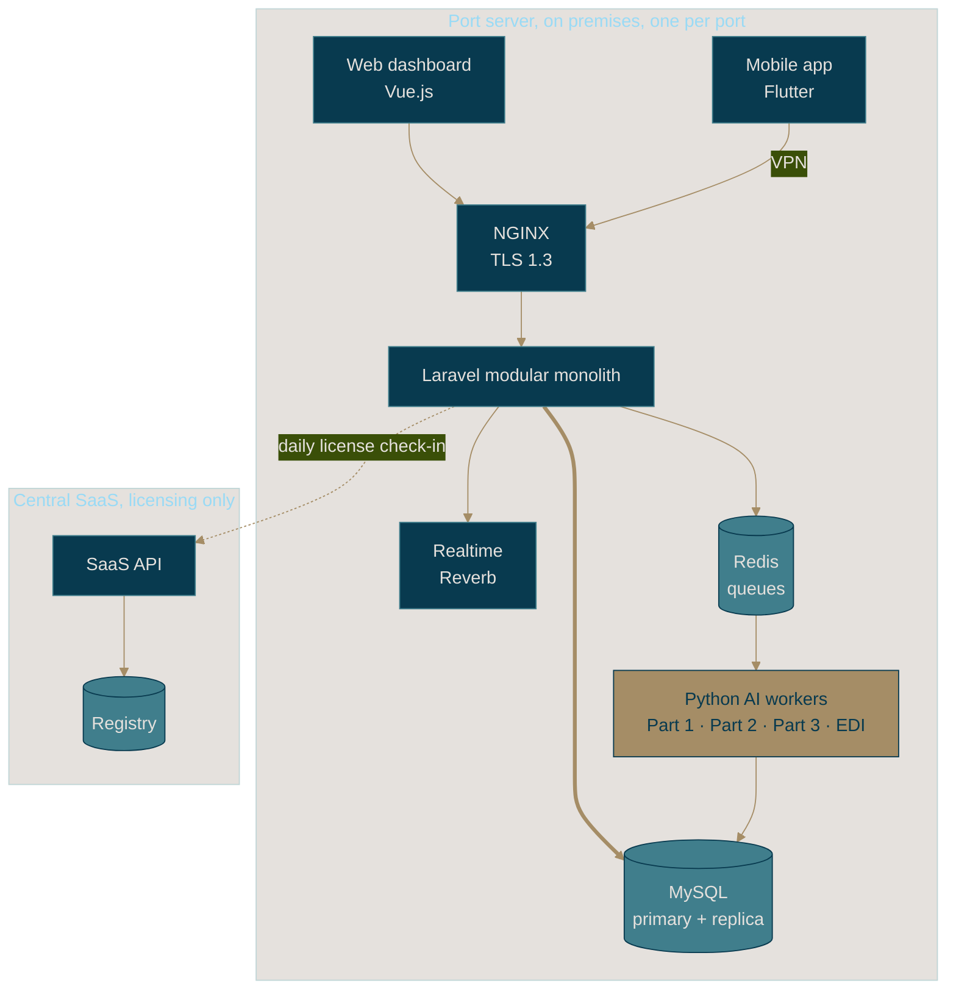

<p align="center">
  <picture>
    <source media="(prefers-color-scheme: dark)" srcset=".github/assets/logo-dark.png">
    
  </picture>
</p>

<p align="center"><b>PortHub</b> &nbsp;|&nbsp; every piece of ATLANTECH, moored in one place</p>
<p align="center"><i>Smarter coordination. Stronger ports.</i></p>

<p align="center">
  
  
  
</p>

<p align="center">
  
  
  
  
  
  
  
  
  
  
</p>


## Why we built this

Walk along any busy port and you'll find a crowd of independent players: the port authority, pilots, tug operators, container terminals, bulk terminals. Each one plans its own day carefully. The trouble is that they all share the same few things: the berths, the channel, the tugs and the pilots. Every party can do its job right and the port still ends up with ships waiting at anchor, missed tide windows and delays that ripple from one terminal to the next.

ATLANTECH is our answer to that. It sits **above** the systems a port already runs (its TOS, its PMIS) and does the one thing none of them do: look at the whole port at once.

> ATLANTECH recommends and coordinates. Existing terminal and port systems execute.

In practice that means:

- working out **when a vessel can safely enter**, given wind, visibility, waves, tide, surge and under-keel clearance;
- proposing **one coordinated plan for berth, tugs and pilot** across every terminal, solved jointly instead of first-come-first-served;
- suggesting **container-yard placement** for the Container Terminal, read straight from the vessel's BAPLIE file;
- **learning from what actually happened** on the quay, locally and carefully;
- and never acting alone. A person confirms the entry window and a person confirms the plan.

## The fleet

PortHub is the umbrella repository. Each part of the system lives in its own repository and is pulled in here as a Git submodule.

| Repository | Built with | What it does |
|---|---|---|
| [**project-backend**](https://github.com/Atlantech-project/project-backend) | Laravel, MySQL, Redis, Reverb | The Port API: business rules, roles, licensing, auditing, realtime, scheduling |
| [**project-ai**](https://github.com/Atlantech-project/project-ai) | Python, OR-Tools, LightGBM, pyTMD | Entry windows, resource allocation, the feedback loop and the BAPLIE parser |
| [**project-frontend**](https://github.com/Atlantech-project/project-frontend) | Vue.js | The web dashboard used by port and terminal staff |
| [**project-mobile**](https://github.com/Atlantech-project/project-mobile) | Flutter | The offline-first app carried by pilots, tug masters and supervisors |

## How it fits together



Every port gets its own full installation, on its own hardware. The central SaaS keeps licenses and the port registry and nothing else. No operational data and no AI model ever leave the port. Inside the port, Laravel hands work to the Python workers through Redis (`queue:part1`, `queue:part2`, `queue:edi`). The workers write their results to MySQL, and the dashboard and phones hear about it over SSE and WebSocket.

## A vessel's journey through the system

```
SUBMITTED
  -> PRELIMINARY_APPROVED
  -> CUSTOMS_APPROVED
  -> AI Part 1 proposes safe entry windows
  -> ENTRY_WINDOW_CONFIRMED        (a person signs off)
  -> AI Part 2 proposes berth, tugs and pilot
  -> RECOMMENDATION_GENERATED
  -> PLAN_CONFIRMED                (a person signs off again)
  -> COMPLETED
  -> AI Part 3 compares the plan with what really happened
```

## Getting the code

```bash
git clone --recurse-submodules https://github.com/Atlantech-project/PortHub.git
cd PortHub

# cloned without submodules?
git submodule update --init --recursive

# bring every component up to its latest commit
git submodule update --remote --merge
```

Each component explains its own setup in its README. If submodules are new to you, [`submodule-setup.md`](submodule-setup.md) is a short field guide.

## How we work

- One `feature/<task>` branch per task, cut from `develop`.
- Everything lands through a pull request.
- Commit and push inside the component first, then commit the new pointer here. This guard catches the case where you forget:

```bash
git push --recurse-submodules=check
```

## The crew

| Track | Name | Role |
|---|---|---|
| AI | Mostafa Mohamed Ragab Rashwan | AI Engineer, Team Lead |
| AI | Menna-Allah Gamal Mohamed Nasr | AI Engineer |
| Backend | Marwan Nabil Mohamed Motawea | Backend Engineer |
| Backend | Menna-Allah Mohamed Magdy Abd El-Kader | Backend Engineer |
| Backend | Mariem Mohamed Mansour Abd El-Gelel | Backend Engineer |
| Frontend | Mostafa Safy Mostafa Soliman | Frontend Engineer |
| Frontend | Mostafa El-Hassanen El-Hassanen El-Sharawey | Frontend Engineer |
| Mobile | Farouk Ahmed Farouk El-Balkiny | Mobile App Developer |
| UI/UX | Menna-Allah Maged Nabil Mohamed | UI/UX Designer |
| BA / QA | Mahmoud Wageh Mohamed El-Sayed | Business Analyst, QA Tester |

## Brand kit

Everything you need to make a screen look like ATLANTECH lives in [`brand-kit/`](brand-kit): clean transparent logos, colours, fonts, icons and ready-made theme code. Each app team takes its own folder and copies it into its repository.

| Team | Take this | What you get |
|---|---|---|
| Mobile (Flutter) | [`brand-kit/flutter`](brand-kit/flutter) | Material 3 light and dark themes, an `AtlantechLogo` widget, 1x / 2x / 3x logos, bundled fonts, app icon and splash images |
| Frontend (Vue) | [`brand-kit/web/brand`](brand-kit/web/brand) | CSS tokens for light and dark, a Tailwind v4 theme, an `AtlantechLogo.vue` component, favicons, bundled fonts |

Step-by-step setup is in the [brand kit README](brand-kit/README.md). Open [`specimen.html`](brand-kit/web/brand/specimen.html) in a browser to see the whole kit in one page.

The full-colour logo is the main logo. On dark backgrounds it sits on a paper card instead of being swapped for a light version, and both components do that for you.

## Our colours

<p align="center">
  
</p>

Deep Navy for trust, Muted Gold for value, the two teals for clarity and growth, and Off-White to give everything room to breathe. Montserrat is our primary typeface and Inter our secondary.


<p align="center">
  <picture>
    <source media="(prefers-color-scheme: dark)" srcset=".github/assets/symbol-dark.png">
    
  </picture>
</p>

<p align="center">
  <sub>Mansoura University &middot; Faculty of Computers and Information &middot; Graduation Project 2026</sub>
</p>
