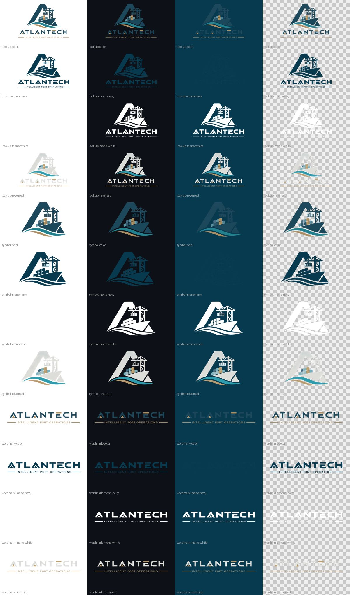

# ATLANTECH Brand Kit

Everything the web dashboard, the mobile app and the UI/UX designer need to look like ATLANTECH: clean logos, colours, fonts, icons, design tokens and ready-made theme code.

The brand and this kit are owned and maintained by Marwan Nabil. Each team takes its own folder; changes to the brand go through him. Version history is in [`CHANGELOG.md`](CHANGELOG.md).



## What's in the box

```
brand-kit/
├── logos/          12 master PNGs (1600 px, transparent), the source for everything else
├── flutter/        drop-in for project-mobile
│   ├── assets/brand/       logos at 1x / 2.0x / 3.0x, launcher icon, splash images
│   ├── fonts/              Montserrat + Inter, static 400 / 500 / 600 / 700
│   ├── lib/brand/          AtlantechTheme, AtlantechTokens (context.atl), AtlantechLogo, AtlantechColors
│   ├── test/               atlantech_brand_test.dart, copy into test/ and run flutter test
│   └── pubspec_brand.yaml  what to merge into pubspec.yaml
├── web/brand/      drop-in for project-frontend (Vue)
│   ├── logos/  icons/  fonts/
│   ├── css/tokens.css          CSS variables, light + dark
│   ├── css/tailwind-theme.css  Tailwind v4 theme on top of the tokens
│   ├── tokens.js               the same values for charts and canvas
│   ├── AtlantechLogo.vue       logo component, primary logo by default
│   └── specimen.html           open it in a browser to see the whole kit
├── design/         for the UI/UX designer (sent as a zip, see below)
│   ├── tokens/atlantech.tokens.json   every token, importable into Figma
│   ├── TOKENS.md                      token table with Figma, CSS and Flutter names
│   ├── swatches/  reference/          palette (.ase, .png) and light / dark renders
│   └── README.md                      the designer's guide
├── tools/          rebuild, check and package scripts
└── CHANGELOG.md    one entry per version sent out
```

## Who takes what

| Team | Gets | How |
|---|---|---|
| Mobile (Flutter) | `flutter/` | Copies it into project-mobile |
| Frontend (Vue) | `web/brand/` | Copies it into project-frontend |
| UI/UX | `ATLANTECH-Design-Kit-<version>.zip` | Sent by the brand owner, built with `tools/package_design_kit.py` |

Everyone works from the same token names: `color/surface-2` in Figma is `--atl-surface-2` on the web and `context.atl.surface2` in Flutter. [`design/TOKENS.md`](design/TOKENS.md) lists every token under all three names.

## Why the logos were rebuilt

The original exports had three kinds of background trouble:

| Source file | Problem | Fix |
|---|---|---|
| `Logo.png` and friends | Edge pixels were blended with white, leaving a pale halo on dark grounds | Edge colours rebuilt from the nearest solid ink, alpha kept for smooth edges |
| `*_مفرغ.png` | Not truly cut out: 90% of the canvas was a faint 3 to 6% veil, which shows as a haze box | Rebuilt from the clean full-colour master instead |
| `Logo_light.png`, `Logo_monochrome_*.png` | Background painted in, no transparency at all | Mono shapes keyed out of their background and recoloured to exact brand hex |

Every file in `logos/` is now fully transparent around the mark, so it sits on any colour, photo or gradient without a box or a halo.

## Logo variants

| Shape | Use it for |
|---|---|
| `lockup` | Symbol + wordmark + tagline. Splash screens, login, about pages, documents. |
| `symbol` | The A, ship and crane alone. App icon, favicon, compact headers, loading states. |
| `wordmark` | Name + tagline. Wide, short spaces such as the top bar of the dashboard. |

**The primary logo is the full-colour lockup** (`atlantech-lockup-color.png`). Reach for it first. Everything else is a variation for places where it can't work.

| Tone | Put it on |
|---|---|
| `color` | **Primary.** White, paper, off-white or light teal. On a dark page, place it on a paper card (`#F7F5F2`) rather than swapping it out. |
| `reversed` | Variation: only where the logo must sit directly on navy or a dark surface, such as an app bar or a dark splash screen |
| `mono-navy` | Light grounds where colour isn't possible (print, fax, stamps, watermarks) |
| `mono-white` | Photos, gradients and strong colour fields |

**Clear space.** Keep empty space around the logo at least the height of the letter "A" in the wordmark.
**Minimum size.** Lockup 140 px wide on screen. Symbol 24 px. Below 24 px, use the favicon tile.
**Please don't** recolour the logo outside these four tones, stretch it, add shadows or outlines, rotate it, or redraw it.

## Colour

| | Hex | Role | Notes |
|---|---|---|---|
| Deep Navy | `#083A4F` | primary, headers, main buttons | 11.2:1 on paper, the workhorse |
| Muted Gold | `#A58D66` | accents, dividers, highlights | 2.9:1 on paper: decoration only. Use `#7A6440` for gold text |
| Light Teal | `#C0D5D6` | soft fills, selected states, primary in dark mode | 7.9:1 against navy |
| Mid Teal | `#407E8C` | links, focus rings, secondary actions | 4.2:1 on paper: underline links or use 18 px+ |
| Off-White | `#E5E1DD` | text on navy, cards, quiet backgrounds | 9.3:1 against navy |

The kit adds a small set of UI colours (paper `#F7F5F2`, dark surface `#04222F`, ink `#0F2A36`, and success / warning / danger). They're tuned to sit with the palette and all reach WCAG AA as text, but they are UI colours, not identity colours, so keep them out of brand artwork.

## Type

**Montserrat** for headings, titles and big numbers. **Inter** for everything people read: body text, tables, labels, forms. Both are SIL Open Font License, bundled here so the apps never need to reach Google Fonts (handy on a port network with no internet).

## Using it in Flutter (project-mobile)

1. Copy `flutter/assets/brand` to `assets/brand`, `flutter/fonts` to `fonts`, and `flutter/lib/brand` to `lib/brand`.
2. Merge `flutter/pubspec_brand.yaml` into `pubspec.yaml`, then run `flutter pub get`.
3. Wire up the theme:

```dart
import 'brand/brand.dart';

MaterialApp(
  theme: AtlantechTheme.light,
  darkTheme: AtlantechTheme.dark,
  home: Scaffold(
    appBar: AppBar(title: const AtlantechLogo(shape: AtlantechLogoShape.wordmark, tone: AtlantechLogoTone.reversed, height: 28)),
    body: const Center(child: AtlantechLogo(height: 120)), // primary logo, paper card in dark mode
  ),
);
```

4. Optional, for the app icon and splash screen:

```bash
flutter pub add dev:flutter_launcher_icons dev:flutter_native_splash
dart run flutter_launcher_icons
dart run flutter_native_splash:create
```

Design tokens are on the theme under the designer's names: `context.atl.surface2`, `context.atl.textMuted`, `context.atl.warning` and so on. When a mockup says `color/surface-2`, that's `context.atl.surface2`. The raw brand palette is on `AtlantechColors` (`AtlantechColors.deepNavy` and so on).

## Using it on the web (project-frontend)

1. Copy `web/brand` to `src/brand`.
2. Import the tokens once, in `main.js`:

```js
import './brand/css/tokens.css'
```

3. Use the variables anywhere:

```css
.toolbar { background: var(--atl-header-bg); color: var(--atl-header-text); }
.card    { background: var(--atl-surface); border: 1px solid var(--atl-border); border-radius: var(--atl-radius); }
h1       { font-family: var(--atl-font-display); }
```

4. Drop in the logo:

```vue
<script setup>
import AtlantechLogo from '@/brand/AtlantechLogo.vue'
</script>

<template>
  <AtlantechLogo :height="40" />                         <!-- primary logo, paper card in dark mode -->
  <AtlantechLogo shape="symbol" :height="28" />
  <AtlantechLogo shape="wordmark" tone="reversed" :height="28" />
</template>
```

5. Icons in `index.html`:

```html
<link rel="icon" href="/brand/icons/favicon.ico" sizes="any">
<link rel="icon" href="/brand/icons/favicon-32.png" type="image/png">
<link rel="apple-touch-icon" href="/brand/icons/apple-touch-icon.png">
<link rel="manifest" href="/brand/icons/site.webmanifest">
<meta name="theme-color" content="#083A4F">
```

(Put the `icons` folder in `public/brand/` so these paths resolve.)

**Tailwind v4?** Add `@import "./brand/css/tailwind-theme.css";` after the tokens and you get `bg-navy`, `text-gold`, `bg-surface`, `text-muted`, `font-display` and friends, all switching with the theme.

**Light / dark.** The tokens follow the operating system. To force one, set `<html data-theme="light">` or `data-theme="dark">`.

## Maintaining the kit (brand owner)

The token values live in four places: `design/tokens/atlantech.tokens.json`, `web/brand/css/tokens.css`, `web/brand/tokens.js` and `flutter/lib/brand/` (`atlantech_tokens.dart`, the type scale in `atlantech_theme.dart`, the palette in `atlantech_colors.dart`). To change a value:

1. Edit it in all four places.
2. Run `python tools/check_tokens.py`. It lists anything that disagrees, down to a single hex value or font size.
3. Add an entry at the top of `CHANGELOG.md` with the new version number.
4. Run `python tools/package_design_kit.py <folder>` to build the designer's zip. It refuses to package while anything is out of sync.
5. Commit, then tell the Flutter and frontend developers to copy their folders again, and send the designer the new zip.

## Rebuilding the logos

If the logo artwork itself changes, rerun the scripts in `tools/` against the Visual Identity folder (Python 3 with Pillow, NumPy and fontTools):

```bash
python tools/build_logos.py "<Visual Identity>" out/logos
python tools/build_kit.py out/logos <fonts-dir> brand-kit
```

`build_kit.py` expects `Montserrat.ttf`, `Inter.ttf` and their `OFL-*.txt` licences in the fonts directory (the variable fonts from github.com/google/fonts).
